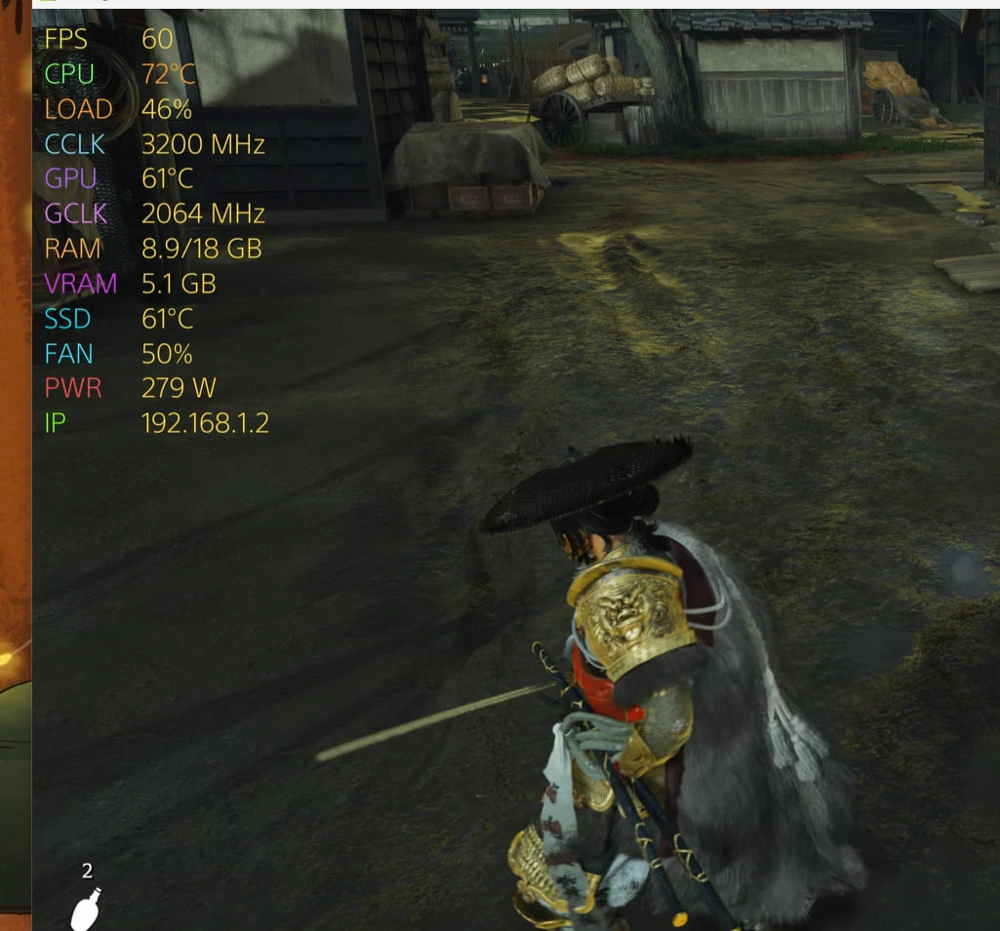
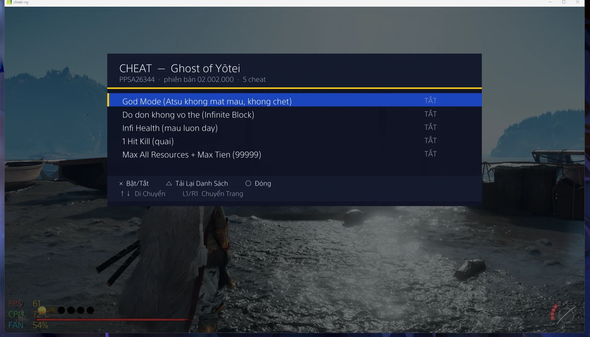
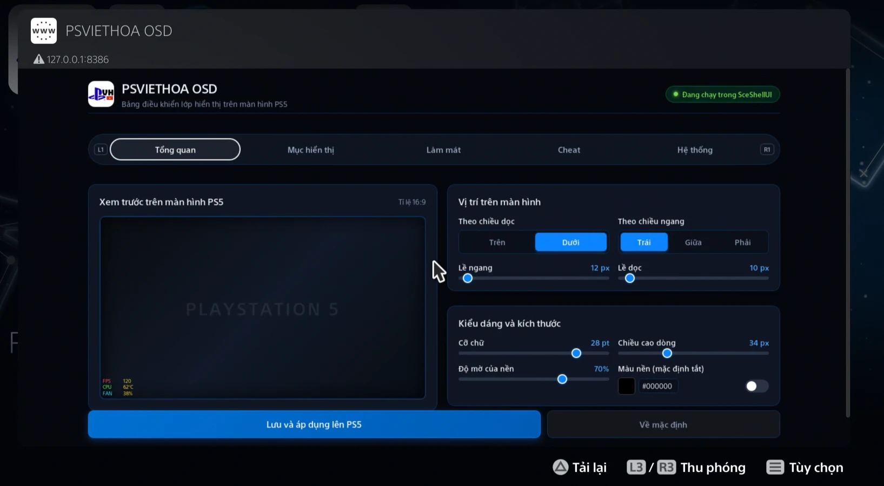

<p align="center"></p>

<h1 align="center">PSVIETHOA OVERLAY</h1>

<p align="center"><b>Tiếng Việt</b> · <a href="README_EN.md">English</a></p>

Lớp hiển thị (OSD) chạy đè lên game trên PS5: xem FPS, nhiệt độ, xung nhịp, bộ
nhớ ngay trong game, chỉnh quạt theo nhiệt độ, và **menu cheat mở bằng tay cầm**.
Mọi thứ cài đặt qua một trang web mở từ máy tính hoặc điện thoại.

Chỉ cần **một file**: `psvh_overlay.elf`.

---

## Ảnh demo

<p align="center">
  
  &nbsp;
  
</p>
<p align="center"><i>HUD hiện thông số ngay trong game · Menu cheat mở bằng L1+R1 (Ghost of Yōtei)</i></p>

<p align="center">
  
</p>
<p align="center"><i>Trang cài đặt mở ngay trên PS5 hoặc từ máy tính / điện thoại (cổng 8386)</i></p>

---

## Tính năng

- **HUD trong game**: FPS, nhiệt CPU / GPU / SSD, tải CPU, xung nhịp CPU / GPU,
  RAM, VRAM, tốc độ quạt, điện năng tiêu thụ, địa chỉ IP. Bật/tắt từng mục, đổi
  thứ tự, vị trí, cỡ chữ. Xếp **cột dọc** (mỗi mục một dòng) hoặc **hàng ngang**
  (một hàng ngăn bằng `|`, tự xuống dòng khi dài). Chỉnh riêng **màu nhãn** và
  **màu số** từng mục; nhiệt và tải có thể tự đổi màu theo mức.
- **Ghi đè quạt**: đặt nhiệt độ CPU mục tiêu (đúng số CPU trên HUD). CPU chạm mục
  tiêu thì quạt được ép quay mạnh, CPU xuống dưới mục tiêu 3 °C thì trả quạt về cho
  máy tự lo ngay. Tab Làm mát hiện cả % quạt thật đang chạy.
- **Menu cheat trong game**: giữ **L1+R1** (đổi được) để mở. Tự nhận ra game đang
  chạy và nạp đúng file cheat.
- **Đọc 3 định dạng cheat**: `.json`, `.shn`, `.mc4`.
- **Tự nhớ cheat đã bật**: khởi động lại máy hay vào lại game, các cheat đã chọn
  tự bật lại.
- **Song ngữ**: máy PS5 để tiếng Việt thì hiện tiếng Việt, ngôn ngữ khác thì hiện
  tiếng Anh. Ép tay được trong cài đặt.
- **Trang cài đặt trên web** (cổng `8386`) và một **ô tile PSVIETHOA.COM** ngoài
  màn hình chính để mở nhanh.
- **Không hook game**: không sửa file game, không cài gì vào game.

## Yêu cầu

- PS5 **đã jailbreak**, chạy được payload ELF qua **elfldr** (cổng `9021`).
- Đã thử trên **PS5 Pro, firmware 10.01**. Các firmware khác chưa được kiểm tra.

## Cách chạy

1. Tải `psvh_overlay.elf` ở trang này.
2. Gửi file vào cổng `9021` của PS5 bằng công cụ gửi payload quen dùng (hoặc cho
   vào danh sách tự nạp).
3. Thấy thông báo **"PSVIETHOA OSD đang chạy"** có logo PSVIETHOA là xong.

Mở trang cài đặt theo một trong hai cách:

- Trên PS5: mở ô **PSVIETHOA.COM** ngoài màn hình chính.
- Từ máy tính / điện thoại cùng mạng: vào `http://<IP-của-PS5>:8386`.

Muốn gỡ, hoặc trước khi nạp một bản mới: vào tab **Hệ thống** → **Gỡ khỏi
SceShellUI**, đợi trang báo đã gỡ xong rồi mới gửi ELF mới. Gửi chồng khi bản cũ
còn chạy sẽ thành hai bản cùng lúc.

## Dùng cheat

### Chép file cheat

Chép file vào thư mục **`/data/PSVIETHOA/cheat`** (qua FTP), đặt tên theo dạng:

```
<TITLEID>_<phiên bản>.json     ví dụ: PPSA04264_01.005.000.mc4
```

Đuôi có thể là `.json`, `.shn` hoặc `.mc4`. Thêm hoặc thay file xong thì bấm
**Đọc lại file** trên web (hoặc **△** trong menu), không cần nạp lại ELF.

### Mở menu trong game

Đang chơi thì giữ **L1+R1** khoảng 0,8 giây.

| Nút | Việc |
|---|---|
| **↑ ↓** | Di chuyển |
| **×** | Bật / tắt cheat |
| **△** | Tải lại danh sách |
| **○** | Đóng menu |
| **L1 / R1** | Chuyển trang |

Tổ hợp nút và thời gian giữ đổi được ở tab **Cheat** trên web. Cũng có thể
bật/tắt cheat thẳng trên web.

### Tự bật lại cheat

Cheat nào đã bật sẽ được ghi nhớ theo từng game. Lần sau vào game, khoảng 6 giây
sau nó tự bật lại và báo bằng thông báo. Danh sách nằm ở
`/data/PSVIETHOA/cheat_tu_bat.txt`, mỗi dòng `TITLEID<tab>tên cheat`. Xoá dòng nào
thì lần sau không tự bật cái đó nữa. Bấm **Tắt hết** trên web là xoá cả danh sách
của game đó.

### An toàn

Trước khi ghi, ELF kiểm tra byte trong bộ nhớ game có khớp với file cheat không.
File cheat của bản game khác sẽ bị **từ chối** chứ không ghi bừa. Dù vậy cheat
vẫn là sửa bộ nhớ game: hãy lưu game trước, và **đừng dùng khi chơi online**.

## Ngôn ngữ

Mặc định là **Tự động**: máy để tiếng Việt thì hiện tiếng Việt, ngôn ngữ khác thì
hiện tiếng Anh. Áp dụng cho trang web, menu cheat và thông báo. Đổi ở tab
**Hệ thống** → **Ngôn ngữ**, bấm **Lưu và áp dụng lên PS5**.

## File trên máy

| Đường dẫn | Là gì |
|---|---|
| `/data/PSVIETHOA/config.ini` | Cài đặt, sửa tay được. Mỗi lần nạp ELF đều đọc lại. |
| `/data/PSVIETHOA/config.ini.bak` | Bản cài đặt trước lần lưu gần nhất, lỡ mất thì chép đè lại `config.ini` |
| `/data/PSVIETHOA/cheat/` | Thư mục để file cheat |
| `/data/PSVIETHOA/cheat_tu_bat.txt` | Danh sách cheat tự bật lại |
| `/data/PSVIETHOA/logo.png` | Logo cho thông báo (ELF tự ghi ra) |
| `/user/app/FAKE08585/` | Ô tile PSVIETHOA.COM ngoài màn hình chính |

## Mã kiểm tra

```
psvh_overlay.elf   961872 byte
SHA-256  67dc4a889b3da4ecfa90c1f6baf651ed7a2aae3f2e4ec068d0ad6073fad65ab7
```

## Ghi công

Phát triển bởi **PSVIETHOA.COM**.

Dùng với rủi ro của bạn. Không liên quan tới Sony Interactive Entertainment.
